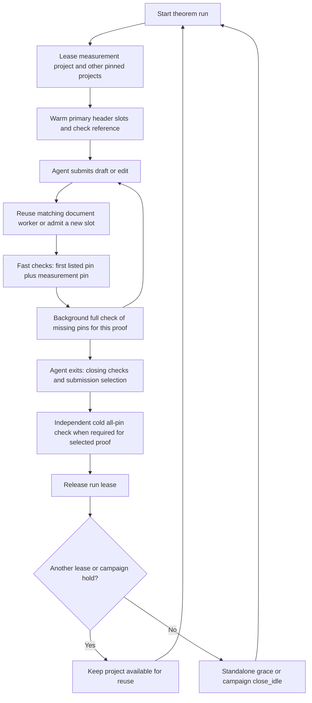

# Lean worker lifecycle and four-pin theorem walkthrough — 2026-10-17

Source audit of the current working tree, including the existing runtime fixes. This builds on [the toolchain audit](../LEAN_TOOLCHAIN_AUDIT_2026-10-16.md), [optimization results](../LEAN_RUNTIME_OPTIMIZATION_RESULTS_2026-10-16.md), and [follow-up measurements](../LEAN_RUNTIME_FOLLOWUP_MEASUREMENTS_2026-10-16.md). Historical measurements below are explicitly from those reports; they are not fresh benchmarks. No provider calls are needed for this investigation.

## What is actually warm?

There are three different resources:

1. **Installed toolchains and provisioned checkouts on disk.** A Lean release is reusable across projects, but each benchmark pin also specifies a source-project commit. Downloaded binaries and compiled dependency artifacts survive worker shutdown.
2. **A shared service entry for a project checkout.** `Session._entry` starts an LSP server in that project and compares fingerprints: toolchain text, source HEAD, lake manifest hash, and loaded evaluator/session code hash. Matching Lean release names alone do not permit sharing project state.
3. **Document workers within that entry.** Each has a scratch URI, loaded imports and pinned file prefix, latest candidate text, diagnostics, and cached result. Multiple slots duplicate substantial elaborated state. Slots have separate model/background lanes.

Sources: [fingerprint](../../arena/lean_session.py#L243), [entry lifecycle](../../arena/lean_session.py#L790), [pinned workspace resolution](../../arena/environments.py), [candidate reconstruction](../../arena/engine.py#L236).

The service is a separate process accessed over `service.sock`; the next run can attach to the same service. Keeping the service process alive does **not** guarantee that its previous document workers remain resident.

## Startup and the two meanings of primary

`engine.measure_version` selects the newest listed pin unless a valid row-specific override exists. `lease_projects` makes that measurement checkout the service lease's **primary** and names the remaining provisioned checkouts as **others**. The runner leases them with its PID and run ID.

The source also uses **primary** for the **first-listed pin**, whose file/line coordinates and probe goals are used by evaluation. Usually these are the same, but Putnam B2 lists v4.25 first and measures on v4.26. Read each usage in context.

The health gate explicitly warms two model workers on the measurement project, checks its reference proof, and derives a check timeout of `min(900, max(60, 3 × warm reference seconds))`. Other pins get asynchronous one-worker background warm-ups and subsequent reference checks. An unhealthy marker stops the run; a session compile success alone does not override it.

Sources: [measurement selection and lease](../../arena/engine.py#L119), [runner startup](../../arena/cli/run.py#L334), [health gate](../../arena/lean_health.py#L110).

## A candidate edit, step by step

1. Normalize and validate the draft, preserving the exact theorem statement and rejecting forbidden constructs. Reconstruct the candidate file from each pinned source commit; the source checkout is not rewritten to a common candidate version.
2. A complete draft takes the `fast` path: first-listed pin, plus the measurement pin if distinct, stopping at the first failure. A hole-containing probe checks only the first-listed pin and cannot score as a completed proof.
3. The configured session receives project identity, complete text, header boundary, prefix hash, lane, and measurement flag. It chooses an idle same-lane slot, preferring an identical header and recent use. Only when all suitable slots are busy does it try to grow the pool.
4. A fresh slot opens **only the imports and prefix** and waits for them before the proof-check clock starts. The full candidate then arrives through LSP `didChange`. The message contains the complete text; Lean handles incremental elaboration. `changed_from_line` reports the first differing line; Arena is not sending a hand-built line patch.
5. Identical text with a cached result returns `unchanged`. A different theorem header closes/reopens the document as needed: server reuse does not imply retaining that theorem's elaborated prefix.
6. A passing complete draft is filed and queued for full compatibility. The full evaluator reuses per-version results recorded for that exact proof, compiling only missing pins. Results from one proof are not evidence for a different edit.

Sources: [proof validation](../../arena/engine.py#L74), [file reconstruction](../../arena/engine.py#L236), [evaluate](../../arena/engine.py#L776), [allocation](../../arena/lean_session.py#L1124), [LSP text/check handling](../../arena/lean_session.py#L505), [batch probe path](../../arena/campaign.py#L1976).

Batching up to four drafts can create simultaneous demand, even though each individual `evaluate` loops through its pins sequentially. The thread pool operates across drafts. Background full checks, salvage, assembly, profiling, and reference checks add other demand; the model lane and background lane have distinct slots.

### Error and timeout behavior

- A Lean proof error returns diagnostics; it need not destroy the worker.
- A timed-out proof with a known header is replaced by that header, cancelling its elaboration while retaining imports (`warm_kept`). Otherwise the document is closed.
- Changed source/toolchain/manifest/evaluator identity invalidates the session. A changed pinned prefix is refused and affected documents are invalidated; this is not an authorized way to edit the theorem's assumptions.
- Service refusal or unavailability can fall back to a direct cold process (`cold-fallback`, with a reason). A session-reported proof timeout itself returns a timeout rather than automatically retrying it cold.
- Queue wait, import-open wait, and proof-check time are distinct. The model queue default is 900 seconds, and import opening has its own 900-second allowance; a 60-second check timeout is not a 60-second total tool latency bound.

Sources: [session check](../../arena/lean_session.py#L557), [prefix guard](../../arena/lean_session.py#L1040), [engine routing](../../arena/engine.py#L580).

## The biggest rows by number of required pins

The benchmark has two four-pin rows: Fiberwise and SKI. B2 has two pins and CCS three, despite their relevance to memory/contention investigations. The current benchmark mapping can be reproduced without starting Lean by reading `benchmark/original/warmup.jsonl` and `engine.measure_version`.

| Row and pin | Normal role | When that pin is used |
|---|---|---|
| Fiberwise v4.31.0 / `c1712f6…` | First-listed and measurement; lease primary | Startup reference; interactive goals/probes/fast complete drafts; heartbeat measurement; full result reuse; independent final cold check |
| Fiberwise v4.30.0 / `e6d77b1…` | Compatibility other | Background warm/reference; full check for exact candidate; independent final cold check |
| Fiberwise v4.29.0 / `de71a9d…` | Compatibility other | Same compatibility role; not omitted just because adjacent releases passed |
| Fiberwise v4.28.0 / `673fa44…` | Oldest compatibility other | Same compatibility role; historically the slow/time-out-sensitive pin |
| SKI v4.33.0-rc2 / `3aa9d44…` | First-listed and measurement; lease primary | Startup reference; interactive goals/probes/fast complete drafts; heartbeat measurement; full result reuse; independent final cold check |
| SKI v4.32.0 / `197a7be…` | Compatibility other | Background warm/reference; full check; independent final cold check |
| SKI v4.31.0 / `8ea71c8…` | Compatibility other | Same compatibility role |
| SKI v4.30.0 / `c7944a9…` | Oldest compatibility other | Same compatibility role; historical candidates exist that pass newest and fail this pin |

Source pin identities: [audit pin table](../LEAN_TOOLCHAIN_AUDIT_2026-10-16.md#runtime-identity-and-version-resolution). No measurement override file was present when checked for this report.

For both rows a normal complete-draft fast check can pass only one of four pins; background promotion still owes three. If it already has exact-proof results for more pins, those can be reused. **An endpoint pass never stands for an unchecked middle pin.** Final cold verification recompiles every pin independently; it also checks the measured heartbeat against the recorded value with the existing 5% tolerance.

The default lane rule sends an `others`-only project to background. However, a project held by a prewarming campaign, or simultaneously primary for another run, can receive model-lane requests. Explicit `lane="background"` remains background. Thus lane is determined by request and current lease/hold state, not permanently by Lean release.

Sources: [lane resolution](../../arena/lean_session.py#L878), [cold verification](../../arena/campaign.py#L3778).

### Why B2 is a useful counterexample

B2's first pin is v4.25.0, but its measurement/lease primary is v4.26.0. A complete fast draft checks **both**, in that order. Its v4.25 request can use an others/background slot; its measured v4.26 request uses the primary model lane. A successful fast result can already cover all B2 pins, so recording its full result need not compile again. A hole probe checks v4.25 only. The earlier tool replay reported two fresh workers across its two pins; that does not prove that a single evaluator opened the pins concurrently.

## When one theorem ends and the next begins

### Standalone run

The runner releases its lease on exit and removes its session environment variables. If no other live lease or hold references a project, its default 120-second release grace begins. A next run acquiring that same checkout within grace can reuse its workers. Cleanup waits for active requests in ordinary grace reaping. Dead run PIDs also lose their leases. An empty service lingers for 600 seconds; installed toolchains and project caches remain on disk.

### Default campaign (`--prewarm-minutes 0`)

The campaign installs no queued-row project holds. On run completion it updates row accounting, then housekeeping calls `close_idle`, bypassing the grace for unreferenced projects. It can stop an unreferenced formerly leased project even if an abandoned background request remains. Projects referenced by another live run survive. Consequently, repeated runs of the same theorem are **not guaranteed warm worker reuse** under the default campaign cleanup; the next run may retain only the service and disk caches.

### Campaign with optional prewarming

The campaign holds the union of projects needed by unfinished rows. After all model/replicate runs for a row finish, it removes that row from the union; projects shared with unfinished rows remain held. The look-ahead estimator polls every 30 seconds and uses observed run durations; it cannot estimate the first transition without completed runtime evidence. It warms the next row's measurement project with one model slot and launches asynchronous one-slot background warm-ups for others.

Holds retain project references, not an unconditional reservation of every worker. Under admission pressure, idle background workers can be evicted, followed by idle workers of projects not leased as a live primary. Same source/version/commit across rows permits server reuse; different files or prefixes may still need a fresh document open. Different sources on the same Lean release do not share their imported project environment.

Examples: SKI and CCS share their v4.33/v4.32/v4.31 CSLib project pins, so prewarming holds can preserve entries across that transition, while their theorem file prefixes differ. Fiberwise and Binius fold share three project pins; Fiberwise's fourth pin can be released if no unfinished row needs it. B2 and Putnam A4/A3 share two pins, with those other rows also needing v4.27.

Sources: [campaign setup and row completion](../../arena/cli/campaigns.py#L1151), [cleanup](../../arena/cli/campaigns.py#L852), [prewarm helper](../../arena/cli/campaigns.py#L1335), [holds/estimator](../../arena/scheduler.py#L121), [release/reaping](../../arena/lean_session.py#L933), [eviction](../../arena/lean_session.py#L1190).

## Memory policy and evidence

- Startup health warm-up requests two primary model slots; request-driven growth caps primary/held/ad-hoc model slots at three per project. Background slots cap at one per project. Model tokens default to eight across daemons; background tokens are extra, so eight is not a total Lean-process limit.
- New slots require room above a 5 GiB reserve. Planning starts at 3 GiB per worker, then uses valid PSS samples with a 0.5 GiB floor, per-open-slot average, and largest-worker bound. Later valid samples maintain a high-water estimate; this is an admission estimate rather than a hard OS memory limit.
- A machine-wide opening lock serializes imports. Allocation/warm-up threads may overlap, but they do not establish simultaneous import loading when that lock works. Already-loaded workers can still elaborate proofs concurrently.
- Reusing an idle matching-header slot before growth and preserving measured-memory admission are existing fixes; this report does not replace them.

Sources: [constants](../../arena/lean_session.py#L45), [opening gate](../../arena/lean_session.py#L210), [admission](../../arena/lean_session.py#L1086), [PSS estimation](../../arena/lean_session.py#L1554).

The October 16 follow-up measured Fiberwise reference startup at 28.715 seconds and a real tactic edit at 4.670 seconds on the same worker, followed by two more reused checks. Fresh one-pin B2 replay took 19.032 seconds for the reference and 0.459/0.394/0.385 seconds for saved edits. These demonstrate incremental reuse; they do not compare equally warmed theorem algorithms. The two-pin B2 tool replay reached 13.81 GiB sampled tree PSS and zero host SwapFree, which motivates bounded contention tests rather than assuming all pins should stay simultaneously hot. Host swap counters are not Lean-attributed.

## Related work in this session

- [Agent-owned final-proof policy and automatic ownership audit](AGENT_FINAL_PROOF_POLICY_2026-10-17.md).
- [Packet forensic audit from saved provider requests](PACKET_FORENSIC_AUDIT_2026-10-17.md).
- [Heavy-worker contention measurements](HEAVY_WORKER_CONTENTION_2026-10-17.md).
- [Optimization cheatsheet from saved successful edits](AGENT_OPTIMIZATION_CHEATSHEET_2026-10-17.md).
- [Failed-history endpoint screening](ENDPOINT_FAILED_HISTORY_SCREEN_2026-10-17.md).

These reports distinguish executed checks from missing coverage. Production endpoint shortcuts and REPL remain disabled; no release pin is dropped from final acceptance.

## Validation in this session

Read-only Python inspection confirmed that the maximum pin count is four, that only SKI and Fiberwise have that count, and that `measure-versions.json` is absent. No Lean process was started by that inspection.

The post-run golf removal passed `ARENA_SLOW_TESTS=0 .venv/bin/python -m pytest -q tests/test_golf.py tests/test_runner.py tests/test_seed.py`: 70 passed, 37 skipped, seven subtests passed. Scoped Ruff checks for the changed runner and golf tests passed.

The additional fake-service/scheduler regression command (`tests/test_lean_session.py tests/test_lean_session_warm.py tests/test_scheduler.py`, slow tests disabled) initially returned 79 passed, 32 skipped, three failures. Two were local-socket `EPERM` failures in orphan-exit tests; the third missed the fake server's `didClose` log during shutdown. A focused rerun of exactly those three checks with local-socket permission passed all three in 2.56 seconds. The third failure did not reproduce; its timing sensitivity remains visible rather than being called a proven sandbox failure. No production session source or existing runtime tests were changed for these results. Real-Lean contention evidence is reported separately in the linked heavy-worker report.
